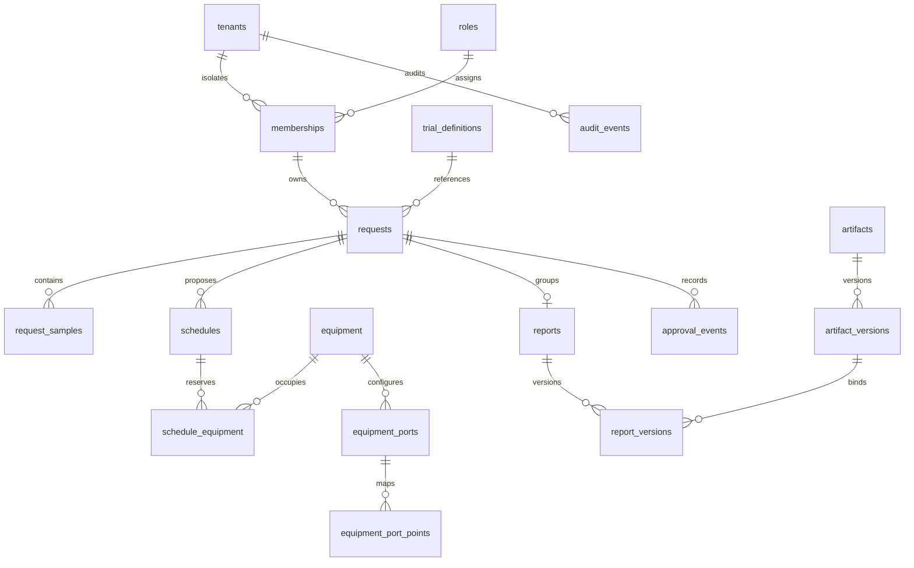

# 業務資料庫第一階段

目標：將目前瀏覽器業務資料的未來共用儲存層建好，先驗證資料結構、隔離、完整性與還原能力。本階段不切換網站、不部署業務 API、不匯入使用者瀏覽器資料、不呼叫模型。

固定來源：`1b85025c445c147222c9020915ae6372a1d5db06`。所有新增檔案限於 `database/`。

## 資料模型

`dqa_business` 有 28 張業務表與 1 張 migration 紀錄表；`dqa_private` 存放權限與完整性函式。

| 分類 | 資料表 | 用途 |
| --- | --- | --- |
| 工作區與身分對應 | tenants, sites, departments, roles, memberships | 組織隔離、部門、場域、角色與平台登入身分對應；不存密碼 |
| 試驗與資源 | trial_definitions, equipment, materials | 試驗目錄、規範版本、設備可用空間 U、物料庫存 |
| 委託 | requests, request_samples | 原始編號、試驗快照、樣品與負責人 |
| 排程 | schedules, schedule_equipment | 起訖、準備與清理時間、設備占用區間與 U |
| 借用與執行 | borrows, material_transactions, lab_operations | 借用草稿、庫存異動證據、試驗操作草稿 |
| 文件與報告 | artifacts, artifact_versions, reports, report_versions, approval_events | 文件中繼資料、不可變版本與 SHA256、試驗與報告對應、簽名參照與審查備註 |
| 管理 | qualifications, quality_records, settings | 人員資格、品質追蹤、非秘密設定 |
| 設備端口 | equipment_ports, equipment_port_points | Modbus TCP／RTU、HTTP JSON 的連線設定及測點；沒有連線執行或控制能力 |
| 稽核與匯入 | audit_events, import_batches, import_rows | 異動欄位稽核、未來匯入的來源雜湊與逐筆檢查 |



各業務子表以 `(tenant_id, id)` 複合外鍵維持同一工作區；`legacy_id` 保留網站既有的委託、設備與目錄編號。同一編號可存在不同工作區，同一工作區不能重複。

## 已實作的資料庫保護

- 28 張業務表均啟用 RLS。登入使用者只取得 SELECT，匿名身分不取得存取權。平台登入必須由可信任 Auth JWT 導出 `auth.uid()`；不信任前端傳入工作區或角色。
- 委託人僅讀取自己的委託、排程與文件；實驗室角色依明確權限讀取本工作區資料；工作區管理者也不能越過其他工作區。停用工作區、角色或成員後立即停止讀取。
- 設備 `space_units` 必填、正整數，代表 Demo 空間單位 U，不是公升換算。庫存不得為負或可用數量大於總量。
- 同設備未釋放的占用區間使用 GiST exclusion constraint 防止重疊；半開區間允許前一筆結束時下一筆開始。容量檢查鎖定設備資料列，禁止分配超量或縮小至既有保留容量以下。
- 報告版本同時綁定同一委託、文件與實際文件版本；簽名參照需是該簽署人的 SIGNATURE 文件。檔案與報告版本禁止修改或刪除。
- 資料庫自動增加 `revision`。未來 API 的更新必須使用 `WHERE id=:id AND revision=:expected_revision`，並檢查 affected rows，避免覆寫其他人的修改。
- 稽核只保存身分、資料表、紀錄 ID、異動欄位名稱與時間，不複製完整業務內容。這不是具外部防竄改保證的正式電子簽章驗證。

部分權限函式需要讀取成員與委託以判定可見性。該 5 張基礎表保留 owner bypass，其他表使用 FORCE RLS。函式固定 search_path、完整限定資料表名稱；用戶不是 owner，也沒有 BYPASSRLS。migration owner 必須有 BYPASSRLS 或 superuser，供受控稽核函式使用；bundle 會檢查此條件。

## 既有 Gate 與未開放能力

```
G2_GATE=NOT_PASSED
P08_STATUS=POLICY_BLOCKED
RULE_NOT_APPROVED=MAINTAINED
```

委託、排程、借用、報告、操作紀錄只允許新增 DRAFT；狀態轉換與正式審查決定會被 `RULE_NOT_APPROVED` 阻擋。審查備註 NOTE 可以保存，簽名驗證值固定 `NOT_VERIFIED`。

這不代表業務流程已開通。正式送簽、開始試驗、報告核准、庫存交易過帳、人員跨排程衝突、250H／20H 與週末規則、端口協定完整驗證，仍須由後續獨立的服務端命令與政策實作。本階段沒有新增可以繞過 Gate 的寫入角色或 RPC。

尚未建立物件儲存 bucket、上傳／下載授權、正式登入、業務 API、即時同步、定時備份或高可用架構。文件表目前是版本與雜湊中繼資料；沒有把假檔案視為真實檔案。

## Migration 與雲端操作

1. 以專案 `mmazbwzdiizabikmiily`／`dqa-smart-lab-dev` 為既有開發目標，先確認專案健康與唯讀 catalog。不可由名稱猜測另一個專案或新建付費服務。
2. `tools/cloud_preflight.sql` 只查 catalog：平台 Auth、角色、schema 是否已存在、PostgreSQL 版本與 extension 依賴。必須先保存回讀證據。
3. 建立 bundle：

   ```bash
   python database/tools/build_bundle.py --out /tmp/dqa-business.bundle.sql
   ```

4. 雲端 bundle 另加 `--expected-public-fingerprint <唯讀盤點得到的指紋>`，在交易前後保護原有 public 定義。指紋比較固定搜尋路徑為 pg_catalog，避免新舊 schema 同名物件的顯示差異。核對 manifest。bundle 含 BEGIN／COMMIT，遇到已存在的 `dqa_business` 或 `dqa_private` 立即停止，禁止 DROP、覆寫或猜測修復現有 schema。
5. 只向已核對的專案套用 bundle 一次。若 API timeout，先回讀 schema 與 migration 雜湊；不要直接重送。失敗交易應整筆 rollback，需回讀確認。
6. 遠端驗收必須回讀 3 個 migration SHA256、29 張表、28 組 RLS、table/function ACL、外鍵、索引、觸發器與空資料狀態，並核對原有 schema 未被改動。不能以本機通過代替遠端驗收。

Supabase Management API 的資料庫查詢端點為 Beta；本階段可使用它在目前網路條件下執行受控 SQL，不需要把管理 Token放入前端或網站雲端設定。不要變更既有 Supabase migration history，也不要將此 bundle 偽稱為既有 public schema 的基準。

**`tests/000_local_platform.sql` 與 `tests/010_synthetic_seed.sql` 只可在隔離本機執行，絕不能套用雲端。** 雲端不產生假帳號、Demo 工作區或自動授權管理者。

## 本機驗收與備份還原

本機 PostgreSQL 17 使用 `--network none`，不發布任何 host port；所有驗收使用合成資料。資料庫狀態檔、密碼、dump 與證據放在 worktree 外，不加入 Git。

```bash
python database/tools/prepare_local.py \
  --directory /workspace/work/business-database-20261121/another-isolated-runtime

python database/tests/verify_database.py \
  --state /workspace/work/business-database-20261121/validated-runtime/LOCAL_DATABASE.json \
  --result /workspace/work/business-database-20261121/evidence/LOCAL_ACCEPTANCE.json

python database/tools/verify_restore.py \
  --state /workspace/work/business-database-20261121/validated-runtime/LOCAL_DATABASE.json \
  --evidence /workspace/work/business-database-20261121/evidence
```

20 組驗收包括跨工作區讀取／關聯、委託與文件逐筆可見性、停用身分、禁止用戶寫入、必填 U、非法庫存／日期、排程重疊、容量、報告版本、簽名對應、版本衝突及 Gate。每次資料異動測試均 rollback。

還原工具使用 pg_dump custom 格式，建立另一個全新本機資料庫，還原 ACL／RLS／函式／觸發器與合成資料，逐表比較 29 張表的紀錄數與內容 fingerprint，再重跑 20 組安全驗收。它驗證備份可還原，不代表 Supabase 已有自動備份或正式災難復原服務。

## 後續資料搬遷對照

| 網站來源 | 目標 | 搬遷前必要檢查 |
| --- | --- | --- |
| `src/trialCatalogStore.mjs`／既有 20 項目錄 | trial_definitions | 保留名稱、aliases、profileId、規範、判定與版本；內建 Demo 標記 SYNTHETIC |
| 委託、覆核與執行紀錄 | requests, request_samples, lab_operations | 多個 localStorage 來源去重、狀態明確映射、孤立關聯拒絕匯入 |
| 設備、物料與借用 | equipment, materials, borrows | U 不由 L 推算；缺漏必要欄位先回報，不能擅補正式資料 |
| 排程資料 | schedules, schedule_equipment | 對應委託、設備、人員、台北日期與完整占用區間；重疊資料先處理 |
| IndexedDB 文件／報告／簽名 | artifacts, artifact_versions, reports, report_versions | 先驗證 byte hash 與對應試驗，再接私有物件儲存；簽名不等於已驗證法律效力 |
| Demo 人員／角色 | memberships, roles | 不搬密碼，不直接把 Demo 身分當正式 Auth；需管理者核對登入身分映射 |

原始輸入以 import_batches／import_rows 留下雜湊與檢查結果；這些表只保存 staging，不自動推進或核准既有案件。資料搬遷與網站切換須另行完成驗收，目前未執行。

設定表僅供非秘密資料；目前 CHECK 攔截已知的頂層秘密欄位名稱，不能代替後續 API 的欄位白名單與秘密儲存服務。不要在設定 JSON、匯入原始檔或設備端口中保存 API Key／密碼。

後續 004 的正式登入、Session 與自有草稿 RPC 接線，請見 [共用業務資料庫接線 Preview](../docs/BUSINESS_CONNECTION.md)。本文件保留第一階段的建置邊界。
