# 財務、報表與全系統列表介面（PR49）

全頁標題垂直置中、列表左右貼齊框格，保留 42px 主頁籤、36px 圖示動作與原本內層頁籤。財務查詢與分頁可同時收合，新增按鈕移至右上；分類欄位與字體放大，篩選統計／年度概覽分開顯示。報表移除領域方塊，搜尋可收合，顯示與匯出設定改為緊湊布局。三系統範本庫統一成表格與圖示操作；設備狀態採目前設備資訊圖示，操作訊息放在標題下方。

原有「介面設定 → 頁籤與列表配色」保留：四組預設、獨立色票／色碼、淺深色預覽與儲存到工作區。財務不同幣別／性質／預估與實際不混加，未估提示、年度範圍、憑證與復原流程保留。

以下截圖使用示意 API；未寫入正式案件、呼叫模型或寄信。私人 Preview 使用共用後端，使用者儲存會寫入共用資料庫。正式站程式尚未更新。

[版面與資料庫接線說明](../workspace-layout-finance.md)

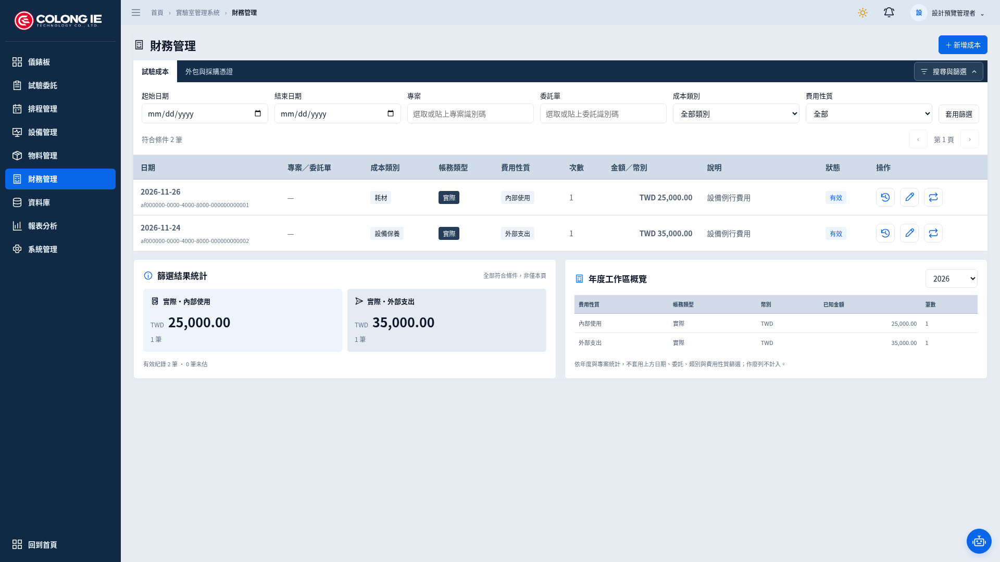

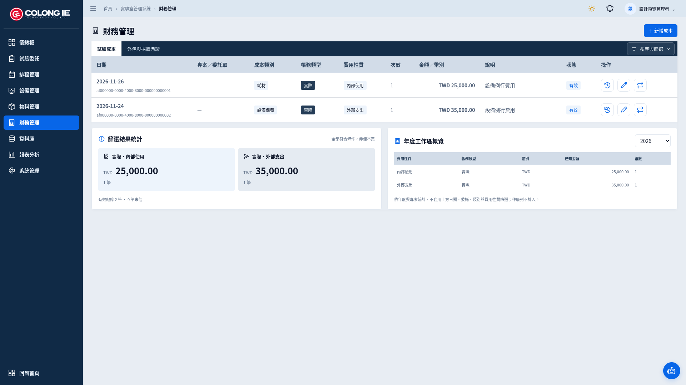

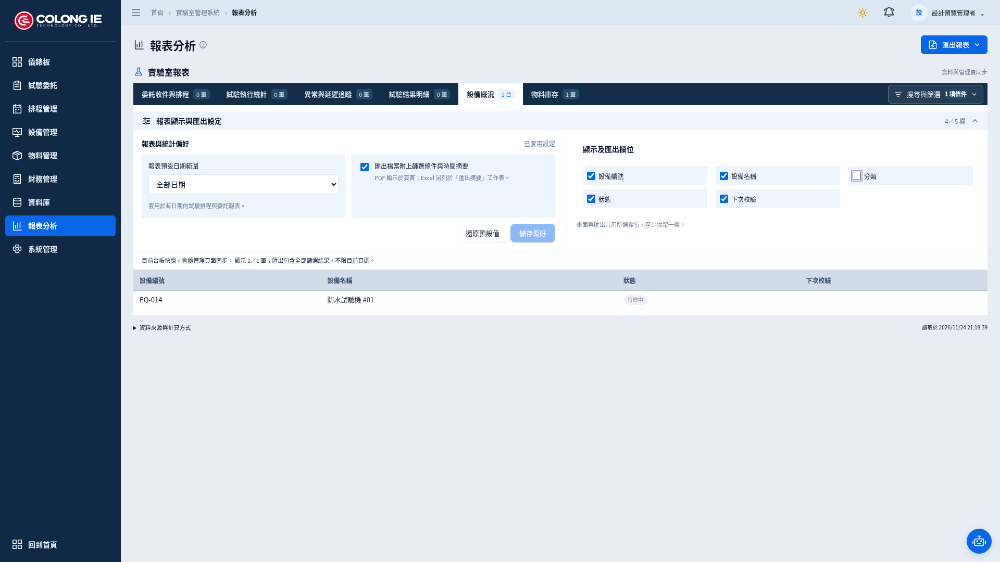

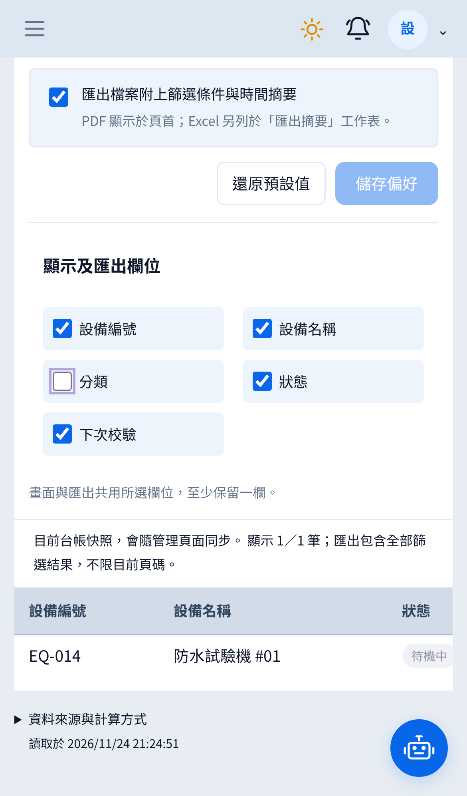

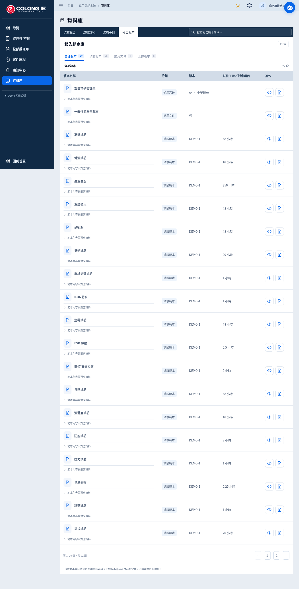

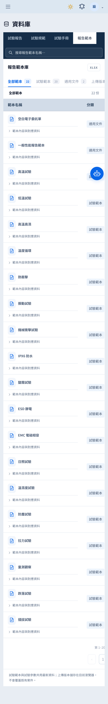

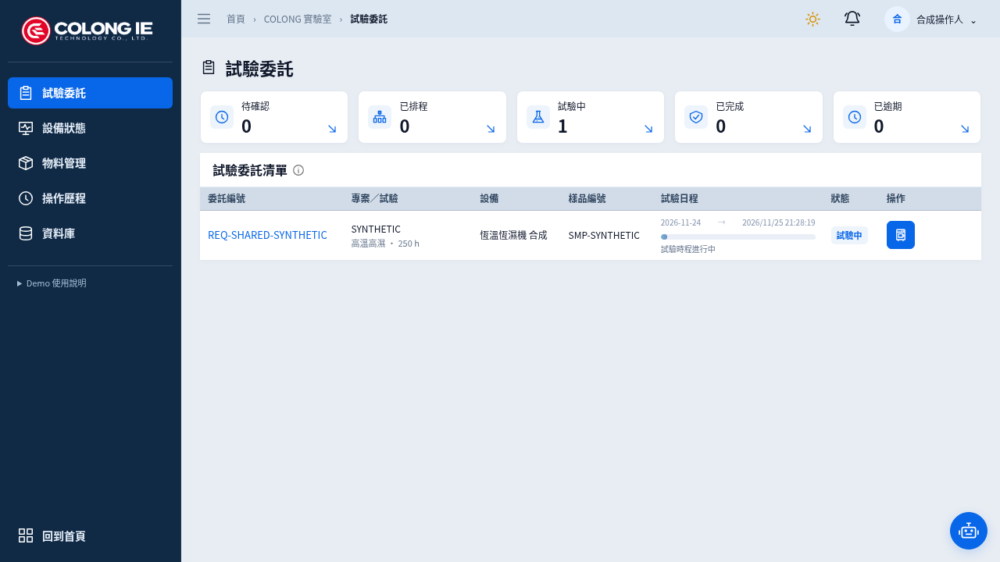

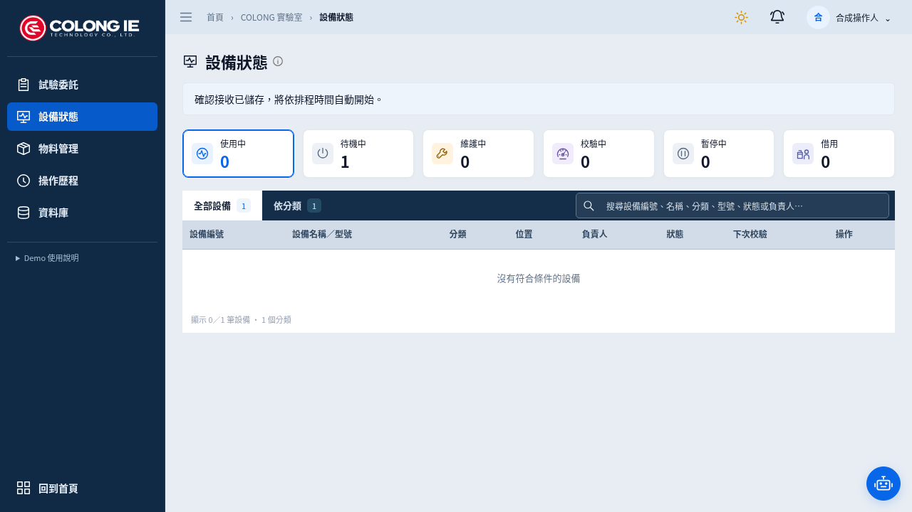

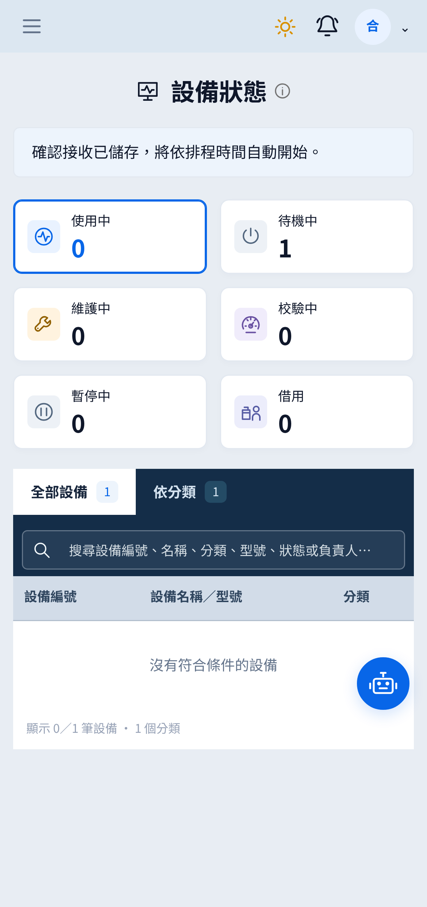

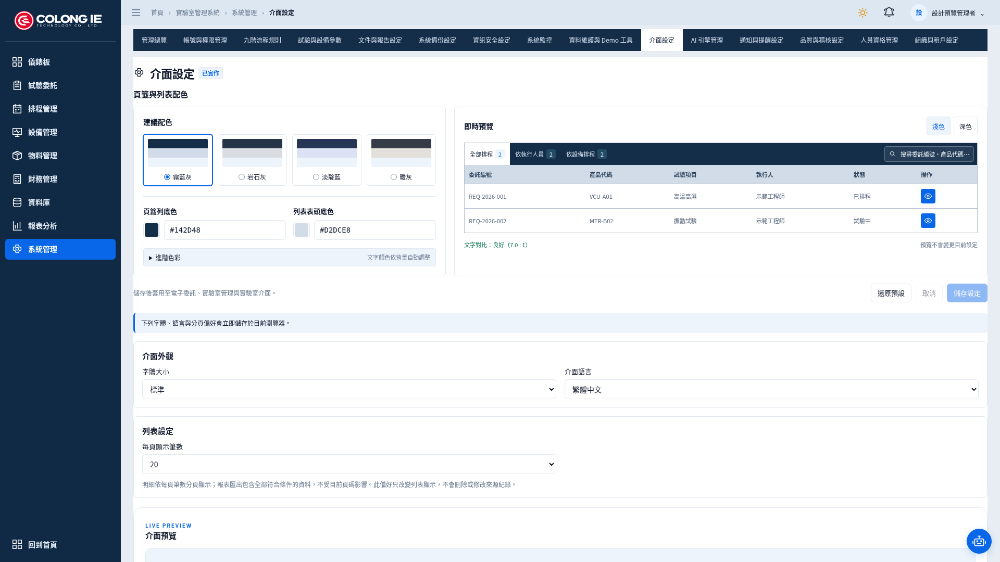

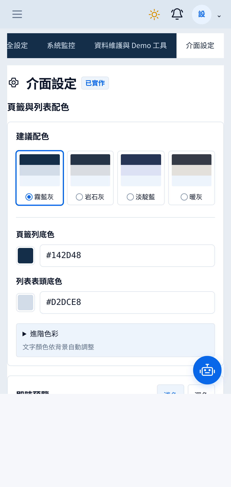

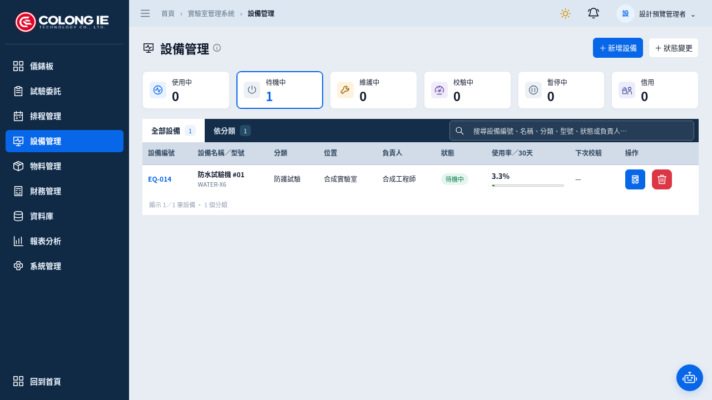

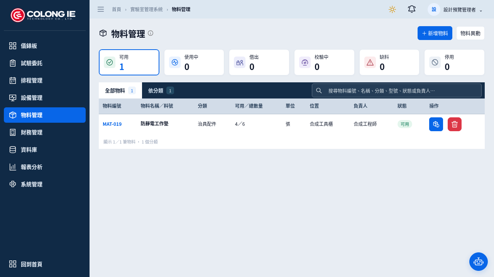

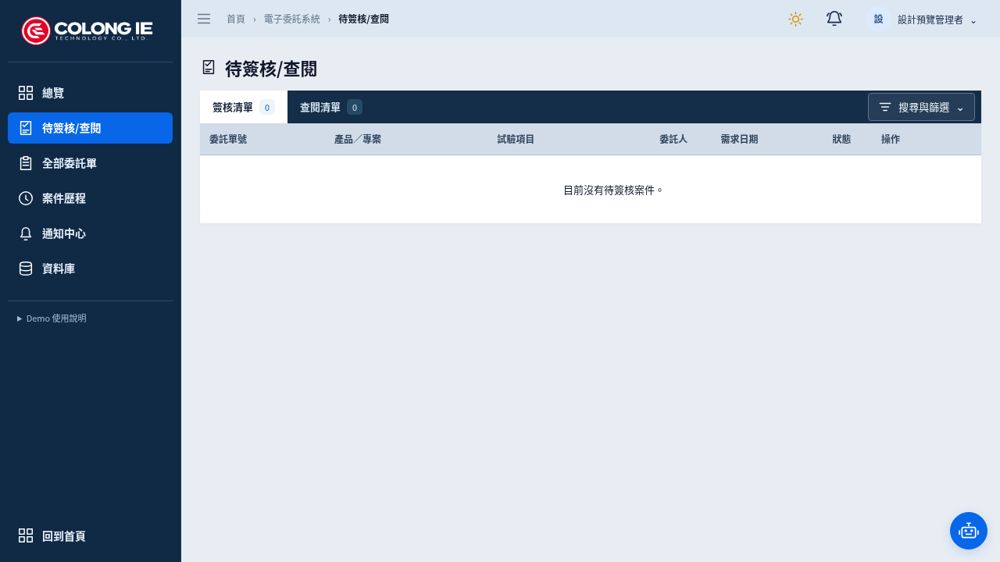

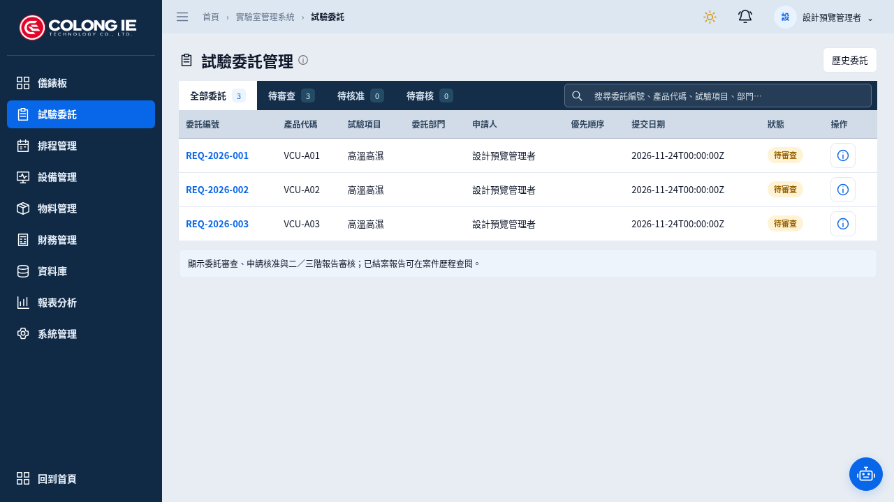

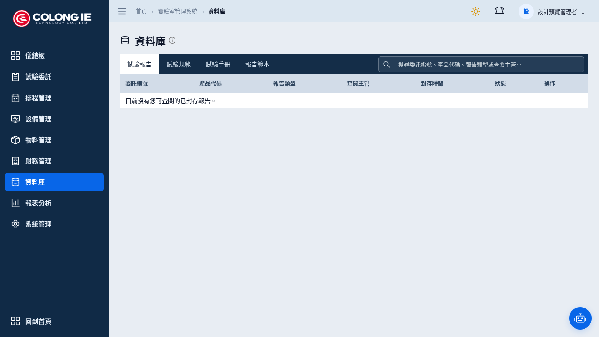

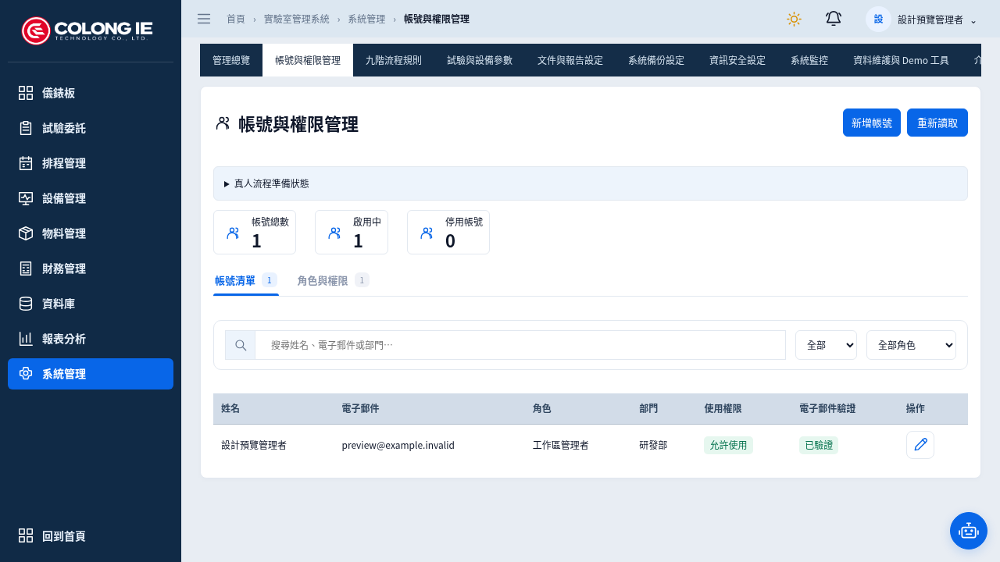

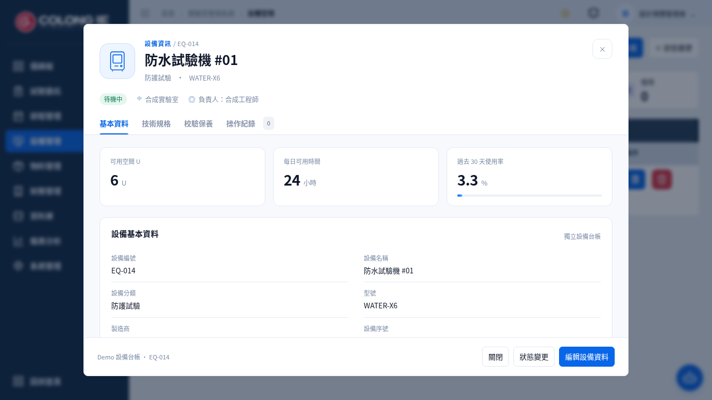
