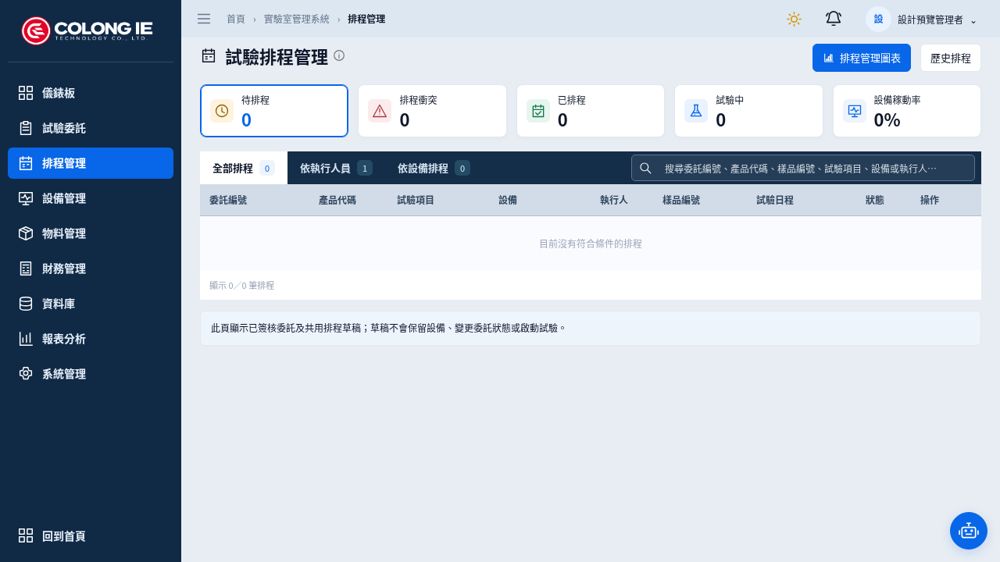

# 工作區配色與共用介面（PR49）

新增「系統管理 → 介面設定 → 頁籤與列表配色」：預設霧藍灰 `#D2DCE8`，可調整頁籤列與表頭底色，提供四組預設、自訂六位色碼、淺深色預覽、自動文字配色、取消、還原預設及儲存設定。

調色只改右側預覽，儲存後才套用到三個系統。資料庫配色由同工作區成員共用，僅管理者可儲存；字體、語言與分頁偏好維持原本瀏覽器設定。主頁籤 42px、一般動作 36px、內層頁籤維持原樣式。

以下截圖使用示意 API，未寫入正式案件或呼叫模型／寄信。私人 Vercel Preview 另接既有共用後端，使用者儲存會寫入共用資料庫。正式站程式尚未更新。

