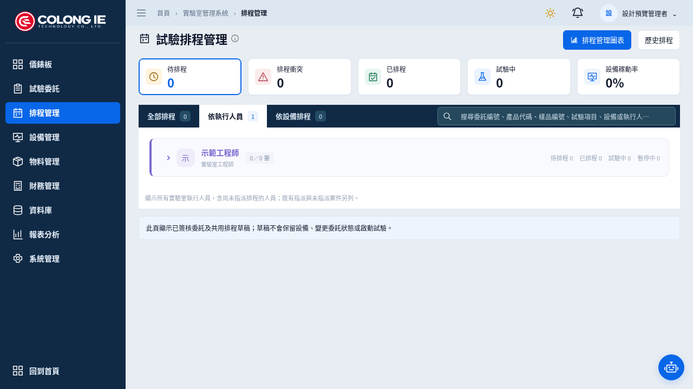
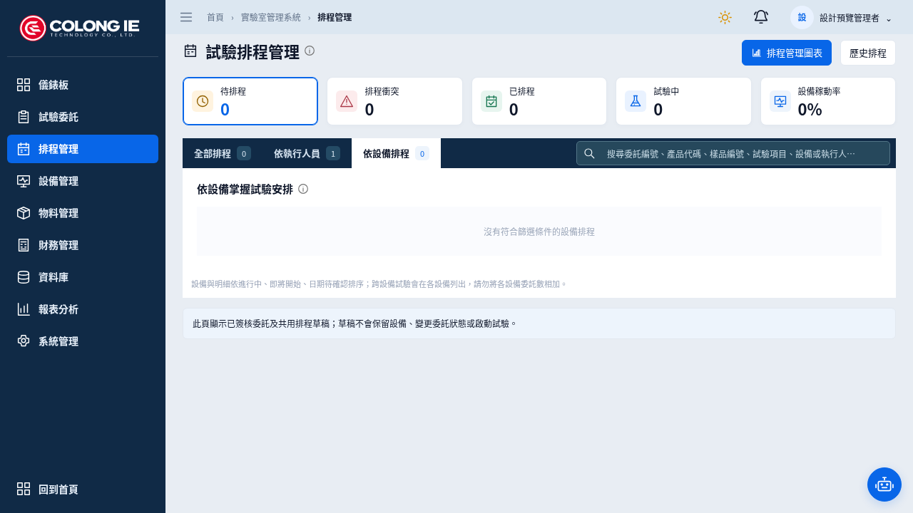

# 全系統頁籤與搜尋設計預覽（PR49）

截圖使用唯讀示意 API，未讀寫正式業務資料，也未呼叫模型或寄信。私人 Vercel Preview 另接既有共用後端，使用者在 Preview 儲存會寫入共用資料。

表頭改為灰綠色 #C5DAD8，搜尋欄改為藍灰色 #26485C。主頁籤列統一 42px、一般功能按鈕 36px，文字及圖示垂直置中。排程收合卡片與副標題距上側、左側均為 20px（手機 16px）。內層頁籤保留原始樣式。

