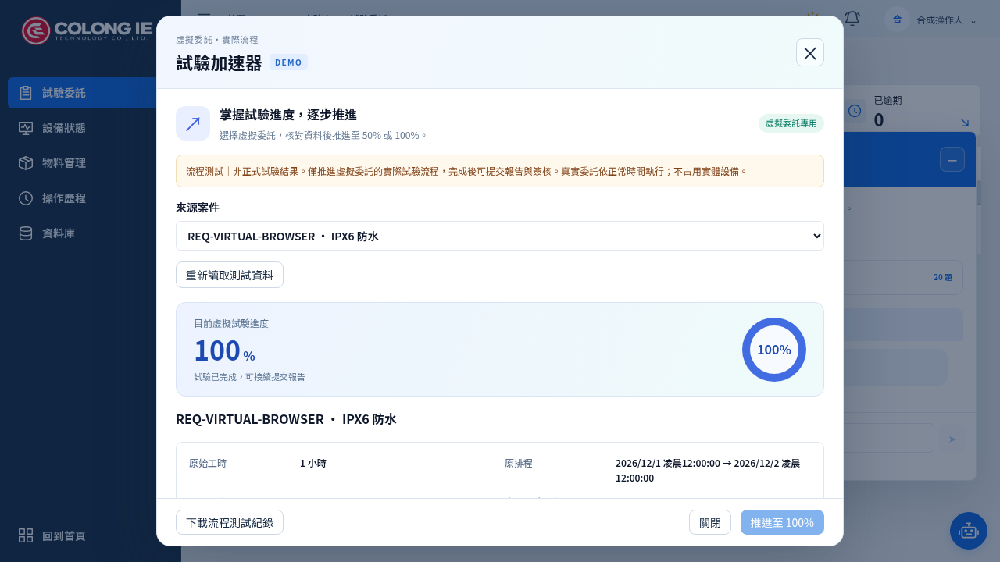
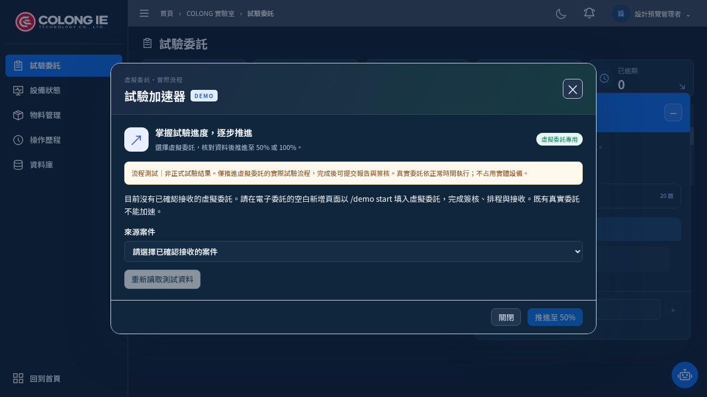
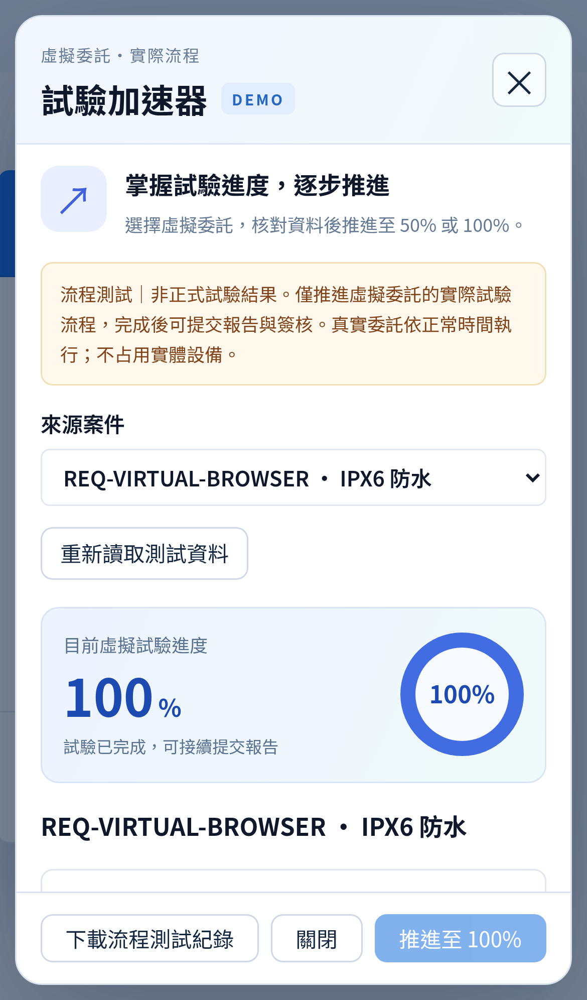
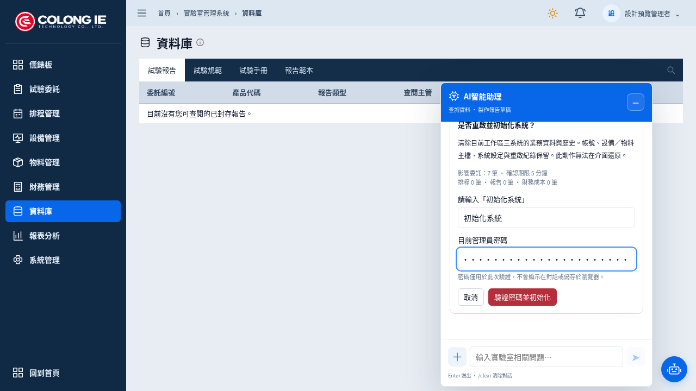

# AI 指令、加速器與入口修正

本次更新維持 PR49 開啟，僅建立受保護的 Preview，不合併或發布正式站前端。

| 指令 | 使用方式 |
| --- | --- |
| `/demo start` | 電子委託的空白新增頁填入虛擬資料；不自動儲存或送出，保留非空白、已存草稿、忙碌與權限檢查。 |
| `/demo accelerator` | LMS／實驗室「試驗委託」開啟新版加速器；核對已確認接收的虛擬委託，逐次推進 50%、100%。不變更真實委託、工時、實體設備占用或簽核程序。 |
| `/demo search` | 任一已登入的系統頁面由機器人回覆總數、流程中與試驗中筆數；資料庫依同一案件去重，不以分頁清單估算。權限受限時明示僅統計可查閱的案件。 |
| `/demo cleanup` | 管理員在機器人中預覽影響筆數並輸入「刪除所有虛擬委託」後，刪除明確標記為 VIRTUAL 的委託與外鍵關聯資料，包含進行中與已封存案件。真實、未知分類與其他工作區保留。 |
| `/system restart` | 僅管理員：機器人詢問是否重啟，顯示影響範圍，要求輸入「初始化系統」及目前管理員密碼。清除目前工作區三系統的業務資料與歷史，保留所有帳號、設備／物料主檔、試驗／文件參考資料、系統設定、帳號圖片及重啟稽核。 |

FAQ「電子簽名可以上傳或使用預設簽名嗎？」改為「查看 AI 機器人指令碼」。指令與指令說明由程式處理，不送模型、不占用 E4 額度，也不會把模型回覆當成可執行指令。

加速器採共用 32px 功能按鈕、漸層頁首、來源選擇、進度卡與圓形進度、原始時窗及模擬時間摘要；支援淺／深色與手機捲動，原有接收、版本衝突、未知結果讀回、報告提交及真實案件隔離保留。

登入頁以各自獨立的 `::-ms-reveal`／`::-ms-clear` 規則隱藏 Edge 原生控制，保留單一自訂「按住顯示密碼」及密碼自動填入。LMS 儀表板移除額外 64px 右側預留，內容回到正常等距邊界。AI 導覽記錄進入前的內部頁面，所有離開／完成按鈕返回原網址；拒絕外站、反斜線與正規化後離開系統路徑的返回值。

## 後端與資料範圍

遷移 `040_assistant_system_commands.sql` 已安裝並讀回驗證；未重跑 036–039。安裝交易核對全部既有資料表內容雜湊、既有 public 定義與非本次異動函式；兩個新私有資料表為空。安裝沒有執行清理或重啟。

清理／重啟先建立 5 分鐘有效的管理員專屬確認計畫，執行時鎖定業務資料並重新核對指紋；來源變動時整筆回滾。只允許固定表清單與精確主鍵，無客戶端提供的資料表或刪除目標。一般不可變歷史的保護保留；只有經確認 RPC 在同一交易選出的精確資料列可刪除，不停用 trigger 或 RLS。跨工作區、非管理員、偽造確認、過期與重複操作均有後端檢查。

重啟需先通過資料庫管理員權限檢查，才由伺服器向 Auth 驗證目前登入者密碼，撤銷臨時驗證登入，再透過僅 service role 可呼叫的完成 RPC 執行。錯誤密碼不清除資料；每份計畫僅允許一次驗證，另有限流。密碼不進入聊天紀錄、瀏覽器儲存、業務 RPC 或模型。結果不明時僅讀回同一操作，不自動再次送出；帳號切換後的延遲回應不會清掉另一帳號的待確認紀錄或更新其畫面。

初始化範圍為目前工作區的業務資料，不抹除平台備份、Supabase Auth 或外部服務紀錄。業務文件索引及存於業務表中的內容一併清除；Storage 物件的底層存留依平台生命週期管理，不宣稱安全抹除雲端備份或物件。

## 驗證

- 桌面／手機完整 52 項案例通過；追加帳號切換的 2 項案例，以及相關重啟／未知結果案例重驗通過，共 54 個不同案例。
- 131 項 Node/API 檢查通過，涵蓋命令分流、導覽返回網址、權限、密碼驗證順序、臨時驗證登出、禁止偽造作用範圍、未知結果與既有 FAQ。
- 隔離 PostgreSQL：22 項新指令測試及 33 項原生虛擬委託回歸通過，全部回滾。包含進行中／封存虛擬委託刪除、真實案件與其他租戶保留、錯誤密碼、過期／過時預覽、管理員撤權、不可變紀錄保護與冪等性。
- 建置、Lint（保留既有專案警告）與 diff 檢查通過。瀏覽器與 API 測試使用本機合成資料，不呼叫模型、寄信或操作正式委託。

[驗證摘要](verification.json) · [資料庫安裝紀錄](schema-receipt.json) · [回滾探測](cloud-rollback-probe.json)

