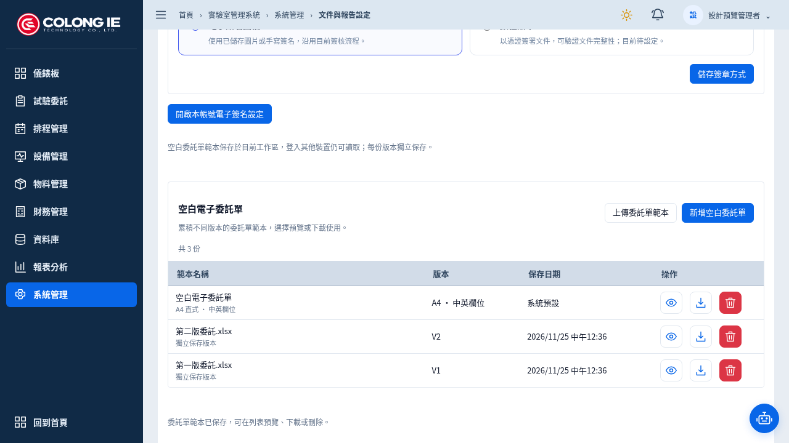
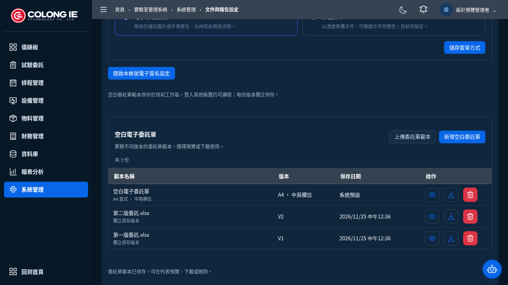
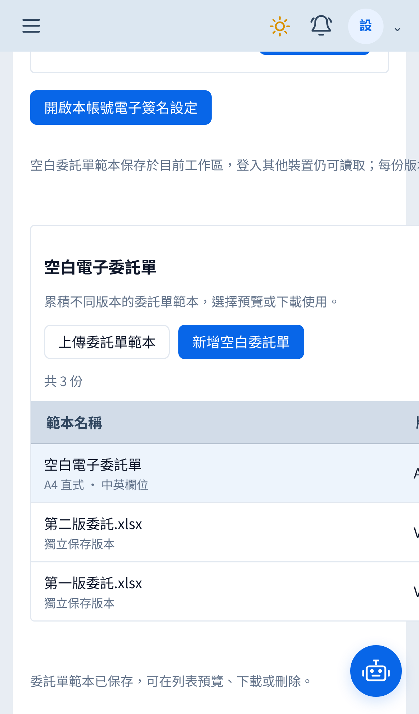

# 空白電子委託單範本列表

「系統管理 → 文件與報告設定」原本只有一張固定的空白委託單卡片，無法累積或刪除。現在在相同位置以列表管理空白範本及不同版本，列出名稱、版本、保存日期與操作。

- 「新增空白委託單」可命名並指定版本，建立獨立的 A4 中英欄位 Excel，不自動送出案件。
- 「上傳委託單範本」保存另一份空白／合成 `.xlsx` 版本；雲端單檔 2 MB，最多 50 份保存版本。巨集、公式、外部連結、過度解壓縮與錯置試驗分類會拒絕。
- 每列預覽、下載與刪除同列排列，維持共用表頭與緊湊列高；較多版本使用既有分頁。預覽沿用全視窗工作表檢視及原始 Excel 下載，沒有 PDF 轉換按鈕。
- 刪除前顯示名稱與版本，取消不變動資料。原本的預設項目也可移出列表；此操作保留新增委託所需的內建表單產生器。保存版本刪除時一併移除其檔案內容。
- 空白版本集中在本區，不重複列在下方其他報告範本版本。三個系統資料庫的「報告範本／上傳版本」可讀取保存版本；移除預設項目也會同步反映。

本次依「空白範本與版本」實作，並非已提交案件的清理功能。一般查閱者可以預覽與下載；管理員可新增、上傳與刪除。既有委託、簽核及報告文件不會因刪除這裡的範本而改變。

## 保存與權限

原先雲端模式沒有接通範本上傳，列表只會得到空陣列。本次增加 041 遷移的三個私有資料表及五個受控 RPC，透過既有登入 Cookie 與工作區權限存取空白範本。沒有匿名讀取或直接資料表權限，不以瀏覽器 IndexedDB 冒充雲端保存；重新登入或換裝置仍能讀取工作區版本。其他種類的雲端範本上傳維持明確的未接通提示，本次沒有宣稱全部試驗範本上傳皆已開通。

保存版本獨立且不覆寫其他版本。原始檔案以 SHA-256 核對，預覽／下載前再次檢查；檔案在私人資料庫保存，不提供公開物件網址。伺服器在解壓縮前檢查管理權限，並核對 ZIP、Excel 結構與內容，資料庫另有大小、檔名、雜湊與權限限制。新增參考範本會由系統初始化流程保留，已在隔離資料庫驗證。

寫入使用操作識別與冪等紀錄。回應遺失時保留待確認識別，只查詢同一操作；不自動重傳。確認視窗內也可查詢結果或關閉，避免被未知結果困在視窗。延遲回應不得更新其他登入帳號，或清除另一個操作的待確認識別。刪除預設項目與保存版本均有版本檢查及不含檔案內容的稽核。

Demo 模式保留原本的瀏覽器保存方式，IndexedDB 升級保留既有上傳版本，再加入預設項目的移除狀態。

## 驗證與發布

- 完整 896 項程式／API 檢查通過；包含真實 Excel 驗證、偽造作用範圍、未授權操作及回應遺失。
- 原生模式 26 項桌面／手機案例通過，涵蓋累積版本、取消／確認刪除、預設移除同步、跨頁讀取、清除瀏覽器資料後讀回、全視窗預覽、上傳與 2 MB 上限、未知結果讀回及唯讀權限。
- Demo 與既有範本／封存檢視 24 項案例通過，包含三系統、320／390／768px、深色、工作表圖片及原始下載。
- 26 項隔離 PostgreSQL 測試通過並全部回滾，涵蓋 50 版本上限、跨工作區、非管理員、原檔與雜湊、不可覆寫、重試不重建已刪檔案、預設項目修訂衝突、稽核及初始化保留範本。
- 建置、Lint（保留既有專案警告）與 diff 檢查通過。041 已安裝一次並讀回驗證，既有資料內容雜湊、public 定義與其他函式保持不變，三個新表為空；沒有上傳或刪除正式範本。

維持 PR49、私人 Preview，沒有合併或部署正式站前端，也不重跑 036–040。

[驗證摘要](verification.json) · [資料庫安裝紀錄](schema-receipt.json) · [回滾驗證](cloud-rollback-probe.json)

