# 獨立頁面與帳號管理版面（PR49）

排程管理圖表、歷史排程、歷史委託採相同頁面標題、配色、直角列表框格與緊湊內距。歷史委託移除重複顯示的母頁工具列；搜尋靠右，表頭與列表貼齊左右框格，返回及既有操作保留。「完成」篩選同時包含資料庫的已完成與已結案紀錄。

帳號管理移除「真人流程準備狀態」區塊，統計採三欄同寬且不可點擊的顯示卡片。帳號清單及角色權限保留原本內層頁籤，搜尋、狀態及角色篩選移至同列右側；表格左右貼齊。新增、編輯、角色儲存與操作結果待確認的恢復流程保留。

這批 29 個瀏覽器案例通過：16 項原生模式版面／搜尋／篩選／返回及手機／深色檢查、6 項帳號資料操作替身驗證、7 項既有 Demo 帳號對話框／甘特圖跨頁同步檢查；3 項模式分流檢查、Lint（既有警告）及原生建置通過。

以下為示意資料截圖。私人 Preview 仍接既有共用後端，使用者儲存會寫入共用資料庫。本次未修改資料庫結構、帳號或正式案件，也未部署正式站程式。

## 排程管理圖表

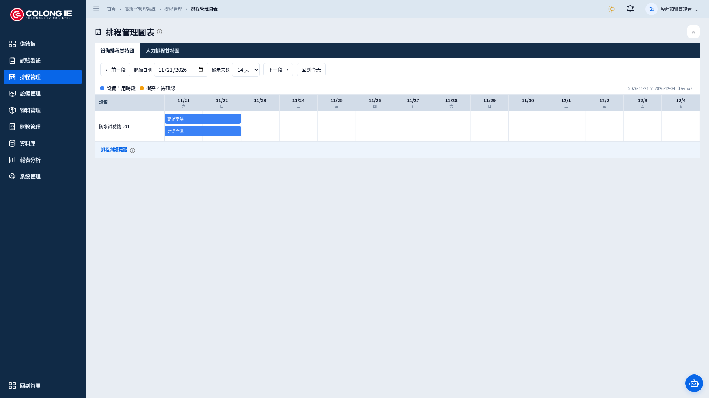

## 排程管理圖表（手機）

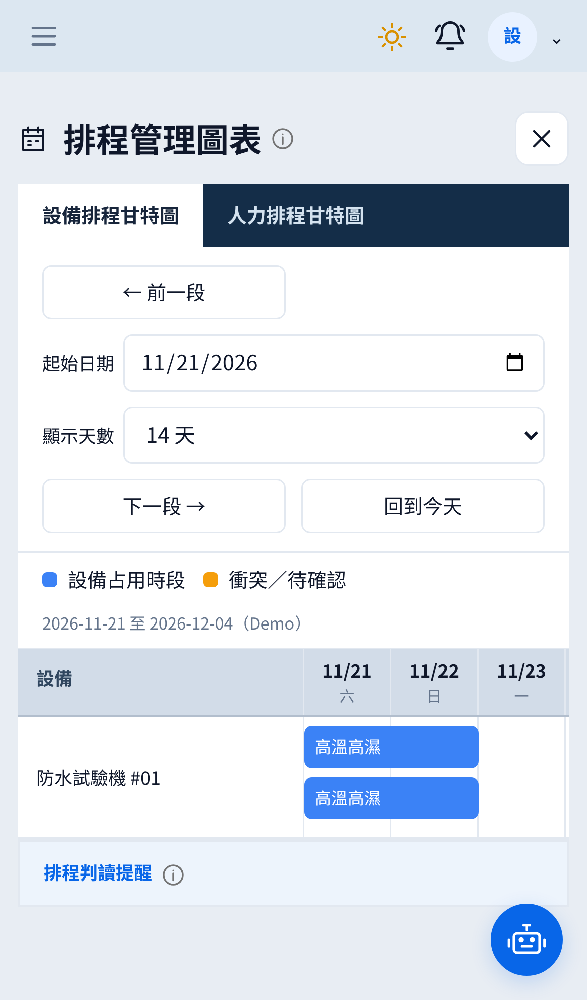

## 排程管理圖表（深色）

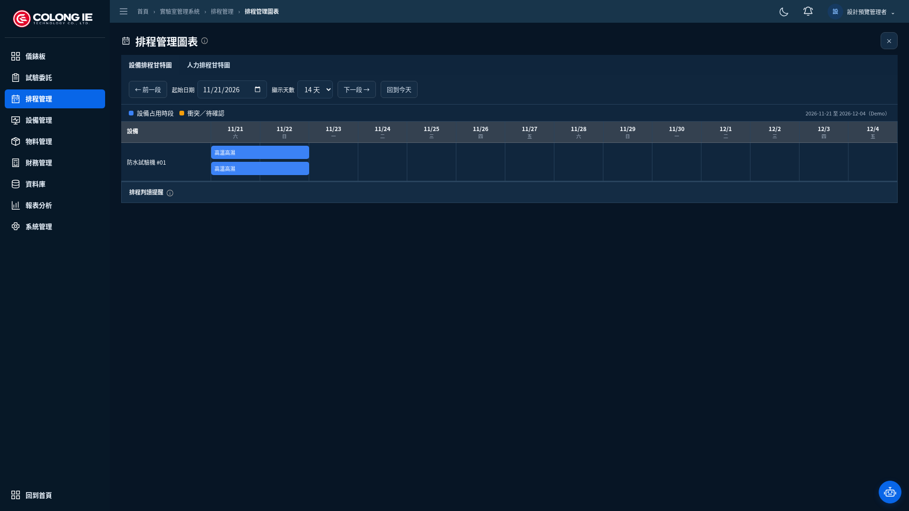

## 歷史排程

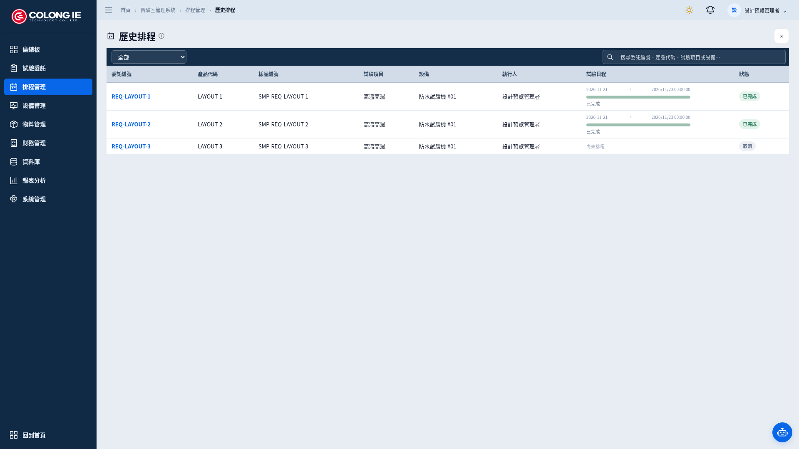

## 歷史排程（手機）

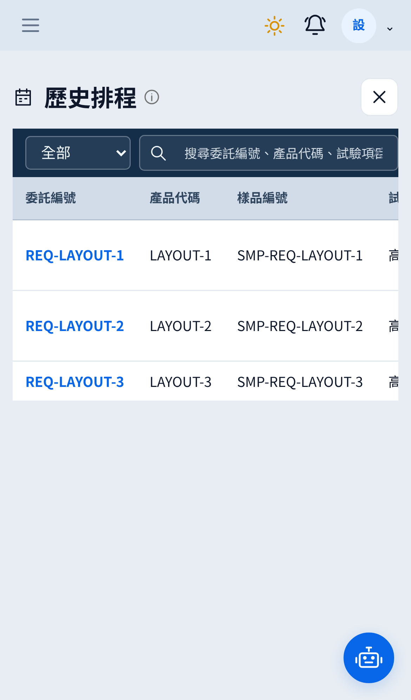

## 歷史排程（深色）

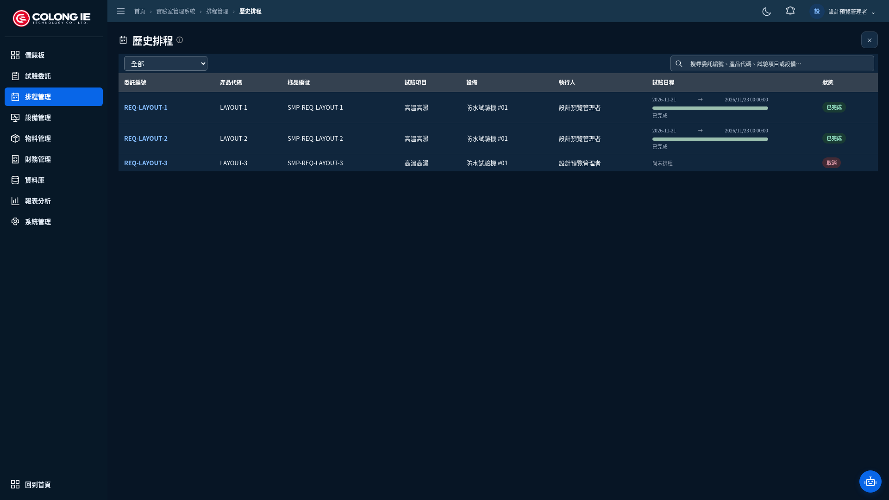

## 歷史委託

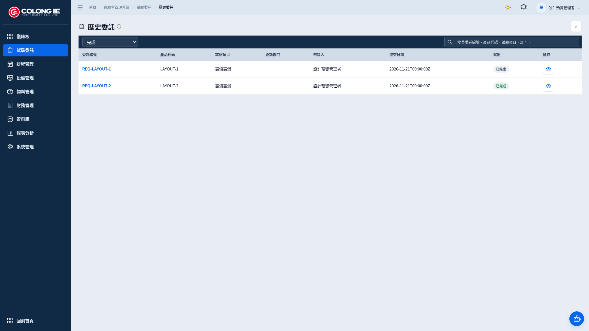

## 歷史委託（手機）

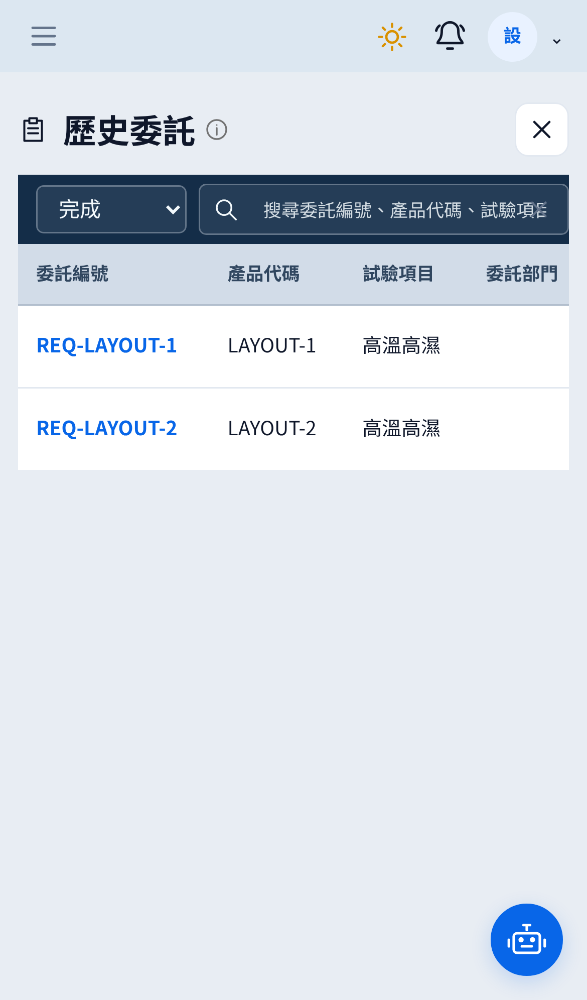

## 歷史委託（深色）

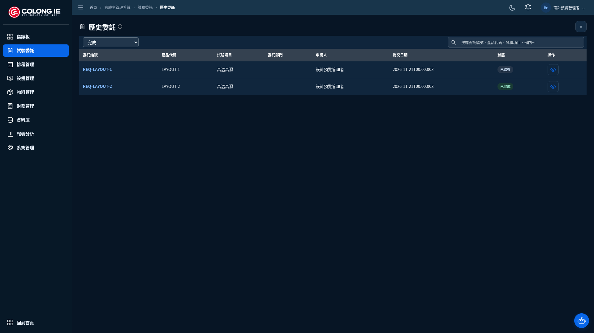

## 帳號管理

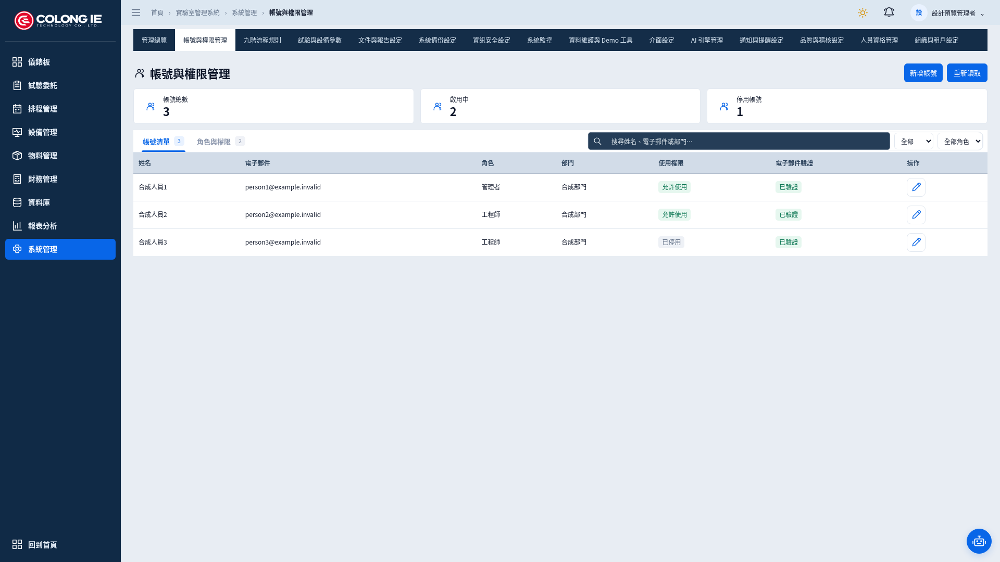

## 帳號管理（手機）

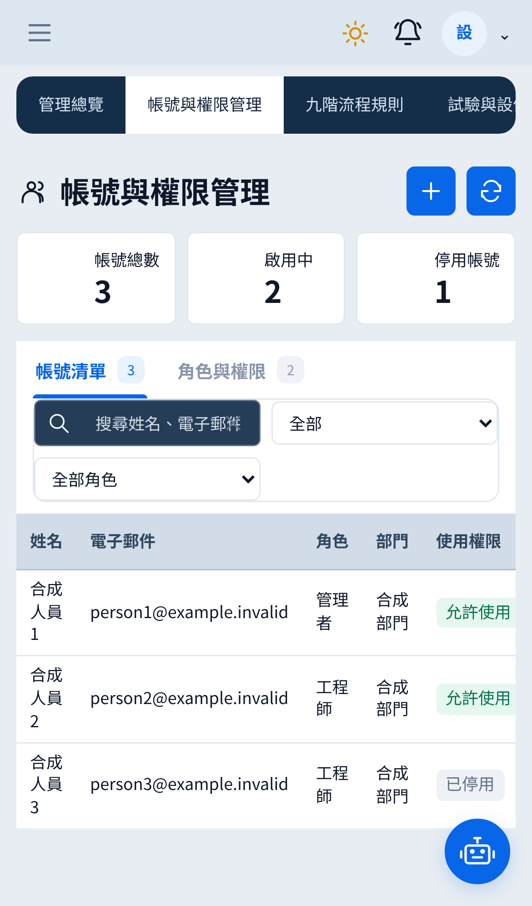

## 帳號管理（深色）

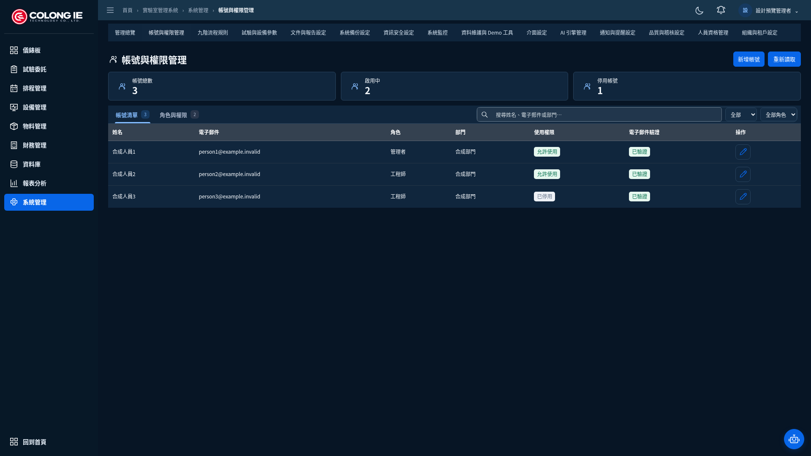

