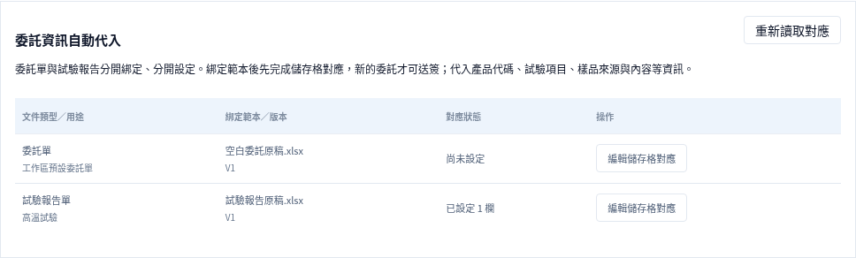
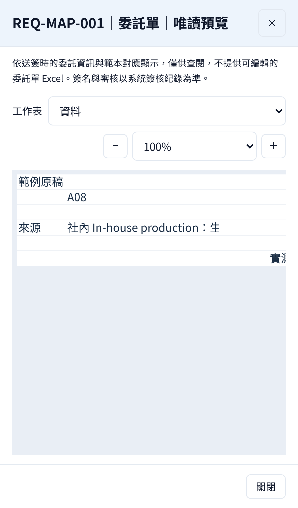

# 委託單與試驗報告：儲存格對應及自動代入

在「文件與報告設定」新增「委託資訊自動代入」。工作區預設委託單與每項試驗的報告範本分開管理、分開設定；試驗綁定移除空白委託單範本庫來源。API與資料庫拒絕將範本庫中相同雜湊的空白委託單重新上傳綁成試驗報告。不自動移除或改綁任何現有設定。

使用方式：先綁定上傳的工作區預設委託單，或在「試驗與設備參數」獨立上傳、綁定試驗報告原稿，再回到本頁選擇「編輯儲存格對應」。選委託欄位、工作表及座標，也可在可縮放的全視窗Excel預覽直接點選儲存格，帶回工作表與座標；「預覽代入結果」使用範例資料，未建立真實案件。設定可修改、增減，同一委託欄位可代入多處。

一次設定1～224個對應，座標限制A1～AV2000，拒絕不存在／隱藏工作表、重複儲存格、合併區非左上角及任意程式／運算式。寫入會取代該儲存格原有文字；其他位置、合併、欄寬、格式與圖片保留。數量為數值，其他欄位以文字或勾選符號代入；以等號開頭的內容仍是文字，不產生Excel公式。委託單的階段簽名在046新增系統紀錄對應；試驗報告仍固定在系統簽核頁，詳見[階段檢核與簽名設定](../workspace-template-stage-fields/README.md)。

產品代碼提示改為「例如:A08」。樣品來源勾選後必須填寫來源內容，例如「社內：生產一課」，並顯示於側邊委託資訊、案件資訊、內建委託單／報告及自訂對應的樣品來源欄位。亦可分別對應來源勾選狀態與來源內容。

新的委託送簽時，同一資料庫交易固定委託資訊、部門名稱、委託單原稿、試驗報告原稿版本與各自的儲存格對應。範本已綁定但未完成對應時明確停止送簽，請先完成設定。修改／改綁只影響之後的提交；重新送簽建立新版本。舊文件不回填、不使用目前設定重寫既有提交。

生成的委託單以送簽快照唯讀顯示，工作表鎖定，完整視窗可縮放，沒有編輯、下載Excel或PDF預覽按鈕；簽名與審核仍以系統紀錄為準。未綁定上傳原稿的案件維持內建委託單。已綁定的自訂委託單亦用於既有案件PDF產生流程，不以目前表單覆寫提交快照。

執行者取得的是已代入委託資訊的試驗報告單，保留結果欄位可填寫。生成時另外加入「系統簽核資訊」，放置委託編號、產品、試驗、來源雜湊、結果摘要B8及三方簽名區，避免簽名覆蓋上傳範本的內容。此工作表名稱保留，不能用於原稿。原報告填寫後，也需在系統簽核資訊B8填寫結果摘要，才能依既有完成試驗→上傳→二／三階審核流程提交；不以範例資料判定試驗合格。

上傳的自訂報告須保留系統簽核頁、原稿識別與所有代入的委託欄位。後端以案件快照核對每個對應儲存格，拒絕竄改產品、試驗、樣品來源等資料及偽造來源／委託編號；未綁定的案件不能偽造此報告類型。簽名位置固定在系統頁，保留現有簽名必填、階段、權限、本人簽核與檔案完整性驗證。結果內容仍由執行者及主管核對。

開啟實驗室試驗委託頁後，延用已指派執行者的自動下載、跨分頁去重及手動重試。下載狀態代表已送出下載要求，不代表作業系統已儲存；多檔可能須允許瀏覽器下載。自動及手動下載都產生同一提交快照的報告，不直接提供空白委託單。舊的自訂報告若沒有對應快照會明確提示，不擅自套用新設定。Demo維持既有流程，新功能需原生工作區。

044新增三張私有表及六個經認證RPC，擴充原綁定／提交固定版本函式。表啟用RLS並禁止匿名、一般登入者與service role直接讀寫；對應設定限工作區管理員，報告限目前指派執行者，委託單限原案件查閱權限。查詢與寫入以Cookie工作區為準，拒絕使用者提供actor／tenant。設定包含修訂比對與操作識別，未知結果只查詢、不自動重送；帳號更換後停止延遲回應。清理／初始化移除案件對應快照並保留參考範本與對應設定。

本機驗收使用API fixture及隔離合成資料庫，未替實際工作區設定對應、上傳／刪除範本、建立／清理委託或執行初始化。雲端安裝先回滾驗證，再單次安裝及讀回，安裝交易核對既有資料雜湊、public定義及其他函式；既有資料、原稿與綁定保持不變。結果與保留證據見同目錄JSON。PR49保持未合併，僅提供受保護Preview。

驗證結果：929項完整程式／API測試、最後137項相關檢查、30項隔離SQL測試通過。桌面／手機的16項對應設定、代入下載、來源輸入及試驗範本流程，另加最後2項唯讀委託預覽，共18項選定案例通過；分批驗證，非一次18項完整重跑。建置、Lint（專案警告）及diff檢查通過。

