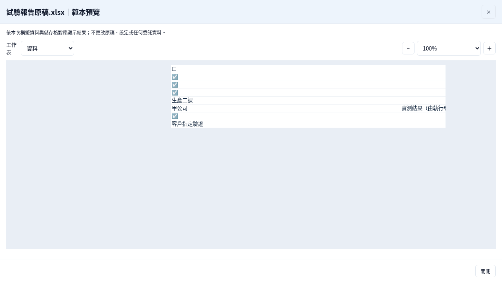
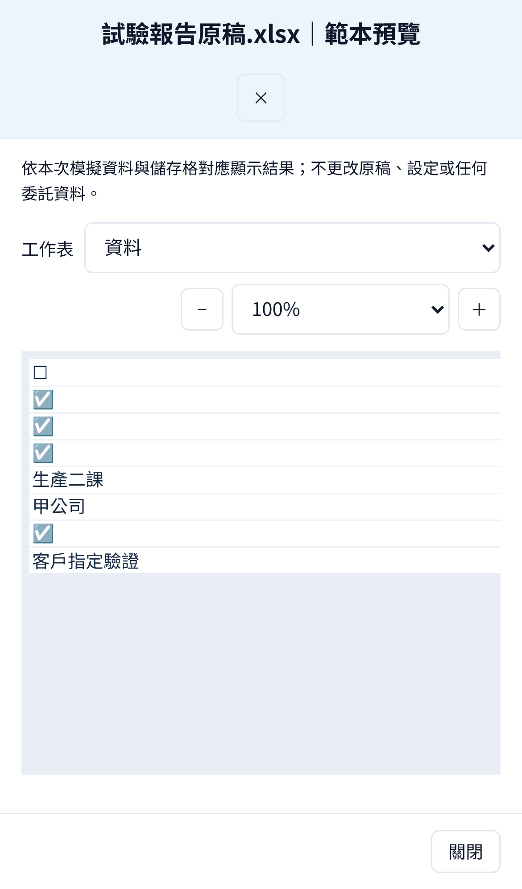

# 勾選欄位、獨立來源內容與對應模擬

「文件與報告設定 → 委託資訊自動代入 → 編輯儲存格對應」的新欄位不再以整段文字混合呈現判定、目的及來源內容：

| 分類 | 新的對應項目 | Excel值 |
| --- | --- | --- |
| 判定 | 勾選需作判定、勾選不作判定 | ☑／☐；兩者依委託所選判定互斥，未指定時皆不勾選 |
| 試驗目的 | 勾選新產品、勾選EV/手工品、勾選再現試驗、勾選其他（請說明）、勾選設計變更、勾選DV/型物品、勾選定期抽測、勾選量產品、勾選PV/本型本工程 | 每項獨立☑／☐ |
| 其他目的說明 | 其他（說明內容） | 僅勾選其他時填入文字 |
| 樣品來源 | 社內（內容）、海外廠（內容）、客戶（內容）、廠商（內容）、競品（內容） | 各自的文字，未選來源為空白 |
| 來源勾選 | 保留五種來源的獨立勾選項目 | ☑／☐ |

每個項目各指定工作表及儲存格，合併區仍選左上角，整格文字仍會被取代，不猜測原稿座標。勾選輸出是Excel儲存格中的符號，未建立巨集或可執行控制項。目的同時支援目前表單的中英文字選項與顯示用EV／DV／PV名稱；不以任意相似文字猜選項。

展開「模擬委託資料（不儲存）」可調整已對應的基本資料、判定、九種目的、其他目的說明、五種來源勾選及各自內容。「模擬值」欄即時更新，按「模擬對應結果」使用目前編輯中的座標與模擬資料，開啟可縮放的完整Excel顯示畫面。模擬資料在開啟時固定，不會因後續狀態變化改用其他內容；可關閉後再改資料或「重設模擬資料」。預覽不提供下載／儲存按鈕，不建立委託，也不把模擬內容寫入欄位設定。真正儲存只保存對應項目與座標。

電子委託表單的五種來源各有自己的內容輸入；多選時，例如社內填「生產一課」、客戶填「甲公司」，不會共用或互相覆蓋。已選來源必填內容，未選內容可保留在草稿中，但不帶入Excel。單一委託及專案共用欄位均送到同一工作區資料庫，重讀草稿、側邊資訊、案件資訊、內建委託／報告及新映射使用相同來源。其他目的選取後也須填說明，送簽時由資料庫再核對。

舊的整合欄位不會自動拆成數個座標。已儲存的判定、試驗目的、來源整合對應仍可讀取、預覽及保存，在該列顯示為既有欄位；新增列則只提供拆分選項。管理者可改選新項目並各指定座標，後續送簽才固定新對應，已提交文件不重寫。

舊資料只有一個來源且只有共用說明時，可明確歸屬該來源內容；多來源的舊共用說明不複製到每個來源，以免誤填。歷史整合欄位保留共用說明，重新編輯多來源草稿時需補各來源內容。未執行任何既有草稿、委託或對應的資料回填。

045只擴充表單文字欄位白名單、儲存格欄位白名單及提交內容檢查，新增一個私有驗證函式，沒有新增資料表或放寬工作區／管理員／執行者權限。既有修訂控制、未知結果查詢、提交快照、不可改寫原稿、唯讀委託單、自訂報告來源及代入資訊檢查、簽核流程均保留。

驗證：943項完整程式／API測試及最後156項相關檢查通過。40項隔離SQL測試包含前一版30項合約與新增勾選欄位、來源型別／逐項必填、其他目的、快照及權限測試，全部回滾。桌面／手機的22項設定、模擬、唯讀及下載案例，另加最後2項來源草稿保存／重讀案例通過；分批驗證，非一次24項完整重跑。建置、Lint（專案警告）、diff檢查通過。

雲端045先回滾驗證，再單次安裝及讀回核對。安裝交易核對所有既有業務／私有資料表內容、其他函式及public定義，未改動任何實際工作區的對應、綁定、範本或案件。瀏覽器寫入為API fixture，SQL為隔離合成資料，未執行實際清理／初始化。PR49保持未合併，只更新受保護Preview。

