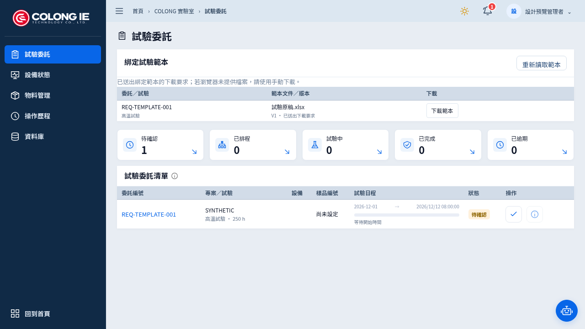
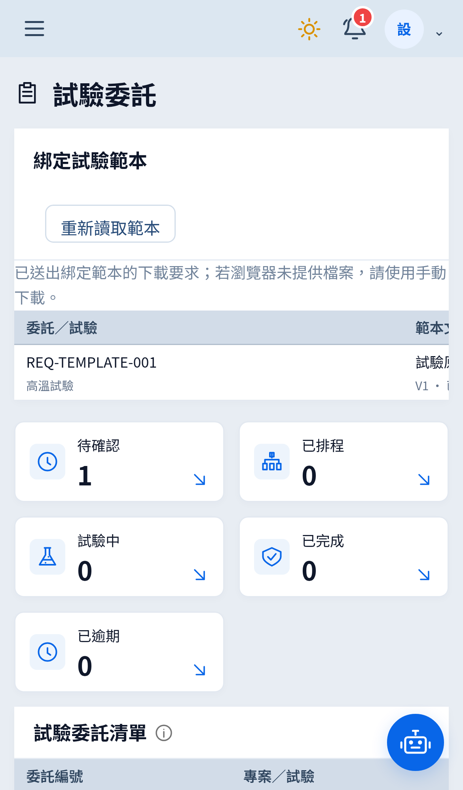

# 試驗項目範本綁定與執行者下載

在「系統管理 → 試驗與設備參數 → 共用試驗項目與方法」的每個試驗項目上方新增「綁定範本文件」。有 catalog.manage 權限的管理者可上傳原始 XLSX、選擇此試驗既有版本、複製已上傳的空白委託單原稿，或解除綁定；每列顯示目前文件及版本。範本預覽沿用全視窗 Excel 縮放，不新增 PDF 預覽。

每個試驗綁定一份檔案版本。接受 2 MiB 以下 XLSX，使用現有 Excel 結構、有效內容範圍、公式／外部連結等驗證；工作區最多保留 100 個試驗範本版本。複製空白委託單時另存獨立、不可覆寫的試驗原稿，不改動空白範本庫或工作區預設綁定。檔名、版本、SHA-256 與原始 bytes 一起保存。

委託者選定試驗、送出文件時，由資料庫觸發器固定當時綁定的檔案。改綁或解除綁定只影響後續送出，已送出的案件繼續使用原版本；重新提交文件則取得新的提交版本。未綁定時記錄空值，之後綁定不會追溯套用。安裝前已有文件不回填，新／後續提交才建立固定版本。

案件到達已指派的實驗室執行者後，執行者開啟「試驗委託」頁會取得「綁定試驗範本」清單，並自動送出下載要求；頁面可見時每 30 秒重讀。瀏覽器未開啟／未登入時不能直接傳檔至本機，需開啟工作頁。多檔下載可能須允許瀏覽器權限，每列均保留「下載範本」供手動取得。

下載領取與發送狀態保存在資料庫，重新整理或其他分頁不重複自動發送。短期領取租約避免並行下載，手動重試可更新失敗的領取。發送紀錄僅代表下載要求已建立，不宣稱作業系統已完成存檔。下載前重新確認登入帳號、目前文件、指派執行者、案件階段、檔案ID、SHA-256 與 Excel 結構。內容錯誤不下載、不改用其他原稿，畫面保留錯誤並可重試；已換帳號的延遲回應停止處理。

委託的既有「下載本案Excel範本」會優先取得固定原稿，未綁定的既有案件維持原流程。這項功能提供指定範本原檔；自訂儲存格對應、試驗資訊自動填入與自訂報告簽名欄位仍需另外設定，原有報告上傳、簽名與審核驗證維持。原生工作區保存至雲端資料庫，Demo 明確顯示需連接工作區並停用新綁定，保留既有 Demo 範本功能。

043 新增 5 張私有表、10 個函式及提交文件觸發器。檔案與綁定按工作區及試驗複合外鍵隔離；所有表啟用 RLS 並撤銷直接存取。經認證 RPC 核對管理權限或目前指派執行者；管理員身分不會繞過案件下載的執行者限制。綁定與提交使用同一試驗鎖，管理操作含修訂比對與操作識別；未知結果僅查詢，不自動重送。清理案件與初始化會級聯移除案件固定版本及下載紀錄，保留參考原稿與試驗綁定。

驗證：913 項完整程式／API測試通過，包含 116 項相關 API測試；80 項既有管理／預覽桌面與手機案例及最後 8 項新增流程案例通過，分別執行，非一次 88 項完整重跑。38 項 SQL測試全部在隔離合成資料庫回滾，涵蓋跨工作區、權限、文件版本、競態、換人指派、階段限制、重試及初始化保留。建置、Lint（專案警告）與 diff檢查通過。詳細結果見 verification.json。

043 雲端安裝前先回滾驗證，再安裝一次及讀回核對。安裝交易比對既有資料內容雜湊、其他函式與 public定義；保留既有資料與範本。未對實際工作區上傳、改綁或刪除範本，也未執行真實委託清理或初始化。PR49 使用受保護的 Preview，保持未合併，不發布 Production前端。

